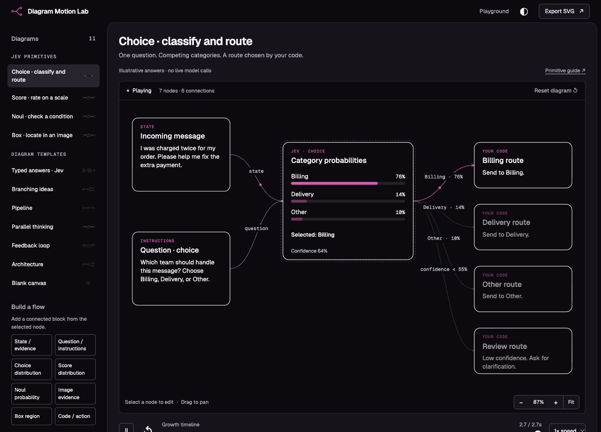

# Diagram Motion Lab

A local-first playground for editorial diagrams, flowing connections, and growing branches. Built with native ES modules, SVG, and CSS; no dependency installation or build step.

## Workflow

We work in **feature branches and pull requests by default**, unless explicitly requested otherwise. No direct pushes to `main`; review locally before merging and publishing. See [CONTRIBUTING.md](CONTRIBUTING.md) and [AGENTS.md](AGENTS.md).

## Run

```sh
npm run dev
```

Open http://127.0.0.1:4178. `npm test` checks graph editing and layout contracts; `npm run check` checks JavaScript syntax.

## Jev DevTools

The reusable React inspector and its sample playground now live in [diegoag64/jev-devtools](https://github.com/diegoag64/jev-devtools). That repo owns the drawer, animated request diagrams, Node recorder, server adapter, installation guide, and sample/live scenarios.

```sh
git clone https://github.com/diegoag64/jev-devtools.git
cd jev-devtools
npm ci
npm run dev
```

Requires Node 22.12+; the DevTools playground runs on http://127.0.0.1:4182/. See its [integration guide](https://github.com/diegoag64/jev-devtools/blob/main/docs/integration.md) for installing the packed library in another React app. It remains a prototype, not a published npm release. The static diagram lab and unlisted `/docs/` replica remain here, with no dependency installation required.

## Playground

- Eleven starting diagrams: four interactive Jev examples (Choice, Score, Noul, and Box), plus branching ideas, pipeline, parallel fan-out, feedback loop, architecture, a blank starting point, and the Jev request/response composition (`?preset=jev`).
- Use **Build a flow** to add evidence, instructions, distributions, Noul probabilities, image regions, and code actions. Edit answer values and thresholds to highlight the active code paths. See [Jev visual primitives](docs/jev-primitives.md) for examples, semantics, and the reusable schema.
- Select a node to rename it, edit its detail, or spawn one to three branches. Branches can themselves spawn more branches.
- Signal, stream, and trace connection effects; independent flow speed and playback speed.
- Six card styles above the canvas: Baseline (open surfaces and rounded outlines), plus Slate (the original filled cards), Soft, Neon, Offset, and Terminal. Styles apply to every preset, work in light/dark mode, persist locally, and carry through static SVG export.
- Replay and scrub the growth sequence. Pause freezes the animation clock. Drag empty canvas to pan; zoom or fit with the canvas controls.
- Undo edits, remove a subtree, and reset a preset. The active diagram and appearance settings are saved in this browser's local storage; switching presets replaces the active graph (Undo can recover it during the current session).
- SVG export produces a complete static diagram, including nodes hidden by the current timeline position, with portable system fonts and the current palette. It does not export animation.
- Reduced-motion preferences show complete diagrams without travel effects. Native controls and SVG nodes are keyboard accessible.



## Structure

- `dist/model.js`: graph schema, presets, immutable editing operations, tree layout, and connector geometry. Nodes own a primary parent for layout; cross-links represent fan-in and feedback.
- `dist/renderer.js`: SVG scene, interpolated layout transitions, connection effects, pan/zoom, and static export.
- `dist/app.js`: controls, timeline clock, undo, persistence, and accessibility behavior.
- `dist/jev-primitives.js`: typed block data, probability math, conditional routes, and four Jev example graphs.
- `dist/primitive-renderer.js` / `dist/primitive-editor.js`: SVG cards and their editing controls.
- `dist/style.css`: extracted/adapted visual tokens and responsive application layout.

To add a concept, add a preset to `PRESETS`. To add a motion treatment, extend the renderer's connection modes. Node `born` times currently drive the reveal sequence; a future scene/event track can add collapse, reparent, and narrative states without replacing the graph model.

## Composition primitives

The Jev preset recreates a supplied reference as editable SVG, using reusable schema fields:

- **Multiline nodes:** `width`, `height`, and newline-separated `subtitle` support explanatory cards. Details can be edited in the inspector, up to four lines.
- **Merge junction:** `kind: 'junction'` creates a point connection without a box. Multiple incoming edges meet at exactly the same point; `arrow: false` removes their arrowheads.
- **Named containers:** `groups: [{id, label, eyebrow, members, focal}]` draws a labeled boundary around member nodes. Its bounds follow the members, with room reserved for its title.
- **Boundary connections:** edge `fromGroup` / `toGroup` connects to a container boundary while retaining semantic `from` / `to` node IDs for ordering and animation.
- **Edge annotations:** `label` draws a readable label alongside a connector with a paper-colored backing. Compact layouts place annotations beside vertical connections.
- **Authored composition:** `layoutMode: 'authored'` uses each node's `position` and `compactPosition` to preserve a specific explanatory layout. It supports multiple input roots and remains editable; new branches are placed in open space below the composition.

The Jev view makes the canvas wider and moves the inspector below it. Containers, labels, multiline text, and junctions are included in complete static SVG exports. Exported text uses portable fonts with preserved text widths. This is an explanatory diagram, with no Jev service integration or live model calls.

The canvas is capped at 40 nodes to keep it useful for explaining concepts. Automatic layout follows a left-to-right tree on desktop and a vertical tree on compact canvases; arbitrary cyclic graph layout and drag-to-reposition nodes are not implemented. Compact canvases start at a readable zoom; use pan to explore or Fit to see the entire diagram.

## Design provenance

Palette, type hierarchy, fine strokes, restrained emphasis, and small radii are adapted from [Cathryn Lavery's Diagram Design](https://github.com/cathrynlavery/diagram-design), inspected at commit `f2f4d49ea8d632f17cf196ba26599277a93f767b`. This playground warms the background slightly and increases interface typography for interaction. The graph renderer and motion system are new implementation, rather than the upstream skill's canonical controller.

The upstream MIT notice is retained in `dist/THIRD_PARTY_NOTICES.txt`. Fonts load from Google Fonts and fall back to installed system fonts when offline. No upstream icon bundle is included. The static diagram playground has no backend, telemetry, or API integration; Jev DevTools has its own server adapter in the separate repository linked above.

## Unlisted docs preview

The TypeSafe introduction layout study is mounted at `/docs/` in the same package and server:

- Playground: http://127.0.0.1:4178/
- Docs: http://127.0.0.1:4178/docs/

`/docs` redirects to `/docs/`. No playground navigation points to the docs route. The page retains `noindex,nofollow`; being unlisted is not an access-control mechanism. This integration is local-only until publication is requested.

Both views import `dist/model.js`, `dist/renderer.js`, `dist/card-themes.js`, and `dist/diagram.css`. The docs use the renderer's read-only mode (complete diagram, no editing or panning, full mobile fit), with their own page layout and appearance preferences. The playground keeps its interactive mode. Changes to shared graph geometry, motion, or card styles affect both views.

`dist/docs/` contains the TypeSafe page layout, condensed rewritten introduction, original Mermaid reference, and public logo assets. It supports Original / Animated comparison, card styles, pause, expansion, theme switching, and local navigation search. Links to other documentation pages go to the official docs. Source reference: https://docs.typesafe.ai/introduction. No TypeSafe analytics or authentication code is included.
