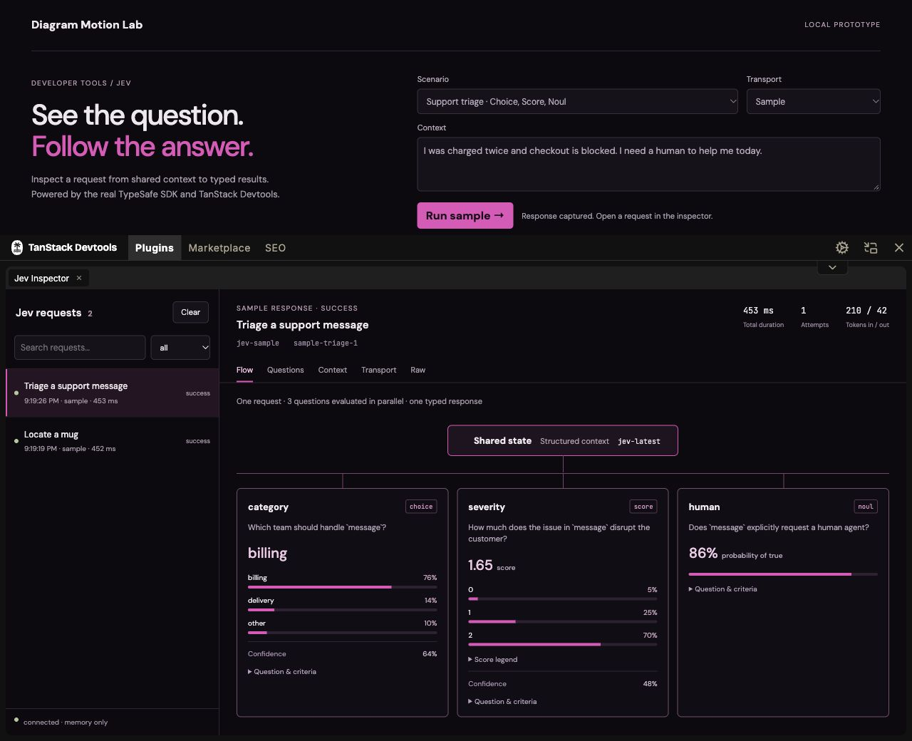

# Jev Inspector prototype

A React plugin inside the **actual TanStack Devtools shell**, using Diagram Motion Lab's dark background, pink connectors, outlined cards, probability bars, and image regions. This is an isolated local prototype; the original lab and `/docs/` stay on port 4178.

## Run

Requires Node **22.12+** (verified on 24.19).

```sh
npm --prefix devtools ci
npm run dev:devtools
```

Open **http://127.0.0.1:4182/**. Run a sample and expand the bottom panel by dragging its top edge. TanStack supplies resizing, docking, closing, and reopening. The Jev plugin supplies a searchable request list plus Flow, Questions, Context, Transport, and Raw views.

- **Support triage:** Choice distribution, Score distribution/legend, and Noul probability.
- **Locate a mug:** Box coordinates over a captured image, plus a separate Noul presence question. A Box is not a presence detector.
- **Rate limit → retry:** a 429 followed by a successful second attempt, recorded as one logical request.
- **Failed request / Cancel:** SDK errors and aborts remain visible in history.

Samples use fixed answers, even when context is edited. They pass through the real SDK's serialization, APIPromise, retry, and cancellation paths using its supported custom `fetch` option. They make no inference calls. Token counts, confidence, model IDs, and request IDs in samples are fixtures, not measurements of a real Jev model.



## Architecture and reuse

```text
React playground → same-origin POST → instrumented TypeSafeClient.systemOne
                                           ↓
                                    recorder.transport(fetch)
                                           ↓
                                sample response OR TypeSafe API
                                           ↓
Browser session ← SSE snapshot ← bounded in-memory recorder
       ↓
<JevDevtools> → TanStack shell → question/answer cards
```

`server/recorder.ts` is the SDK adapter. It wraps `systemOne`, snapshots semantic inputs before serialization, and returns the **original APIPromise**. A cloned response supplies inspector data without consuming the caller's body. AsyncLocalStorage correlates each HTTP attempt with its call, including retries and concurrent requests. Other methods keep the SDK's receiver.

```ts
import {TypeSafeClient} from '@typesafe-ai/sdk';
import {JevRecorder} from './server/recorder';

const recorder = new JevRecorder({
  limit: 50,
  redact: (path, value) => path.at(-1) === 'email' ? '[redacted]' : value,
});
const jev = recorder.instrument(new TypeSafeClient({
  apiKey: process.env.TYPESAFE_API_KEY,
  fetch: recorder.transport(globalThis.fetch),
}), {session: 'your-session', label: 'Classify a ticket', source: 'live'});
// Use jev.systemOne(...) normally; keep this code on the server.
```

`src/JevDevtools.tsx` exports the React adapter and panel. Supply the current `Trace[]`, connection status, and async `onClear` callback. The playground keeps its SSE subscription outside the panel so closing it does not interrupt collection. `src/protocol.ts` defines the browser-safe snapshot contract. This is source code to evolve, not a published npm package or drop-in integration for every React framework.

The plugin intentionally uses its own session-scoped SSE bridge, not TanStack's shared server event bus. The Vite middleware and same-origin guards are local prototype infrastructure. A real application integration will need framework-specific server hooks and authenticated, authorized trace delivery.

## Optional live mode

Copy `.env.example` to **`devtools/.env.local`**, set `TYPESAFE_API_KEY`, and restart. No key is accepted by the browser. Select Live to call Jev with the triage or image example; retry/error fixtures remain sample-only. Live requests may incur API charges. **This prototype was verified with samples only.**

The image example uses `jev-preview` and `TypeSafe-Danger-Zone-Images: true`, per the current SDK/API contract. Image support is experimental. Samples should not be treated as evidence of live model accuracy or capability.

## Capture boundaries

- Captures `systemOne` calls made through the wrapped client; it does not intercept unrelated network traffic or auto-discover all clients.
- Keeps at most 50 requests **across all sessions** by default; clearing affects only the selected session. Restarting the server loses history. Browser reload reconnects to the same session.
- The browser stores only its random session ID in sessionStorage; TanStack persists its own layout preferences. Request bodies/results remain in process and browser memory, not durable storage.
- Credential-named fields are redacted recursively, and the demo also redacts `email`. Custom redaction runs on input and response snapshots. Arbitrary secrets inside free text are **not** automatically detected. SDK request options/headers are not captured. Error messages are bounded, with Bearer tokens redacted.
- Captures have depth, collection, and text budgets. Small PNG/JPEG byte-array images can have inline previews; Blob/large/unsupported images expose references and sizes. Truncation/omission warnings are visible.
- Total latency covers the logical call; attempt latency ends at response headers. Jev provides a batch response, so no per-question latency or hidden model reasoning is invented. The diagram represents request structure, not internal neural processing.
- Results show server-supplied answers, distributions, and confidence. The inspector does not turn a distribution into a new routing decision or add confidence to Noul.
- Server listens only on `127.0.0.1:4182`, checks Host/Origin, isolates snapshots by random session, and caps concurrent runs. This is not a public multi-user authentication system. Do not expose it over a tunnel.
- `npm run build` verifies bundling but produces only a local-tool notice: the UI is development-only and the recorder is a Vite serve-only plugin. No production deployment is included.

## Verification

```sh
npm run check
npm test
npm run check:devtools
npm run test:devtools
```

Recorder tests use the real SDK at its public transport boundary: APIPromise response ownership and typing, retries, errors/abort, concurrent sessions, redaction, bounded retention, and multipart image capture. Browser verification covers all scenarios, drawer resize/reopen, context/criteria, status filtering, and clearing history.

Sources: [TanStack React adapter](https://tanstack.com/devtools/latest/docs/framework/react/adapter), [custom plugins](https://tanstack.com/devtools/latest/docs/building-custom-plugins), [TypeSafe JavaScript SDK](https://docs.typesafe.ai/sdk/javascript), [Box](https://docs.typesafe.ai/primitives/box). Versions are pinned in the lockfile; TanStack Devtools APIs are still evolving.
